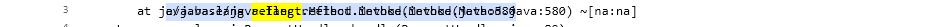
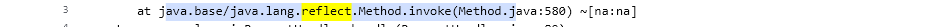
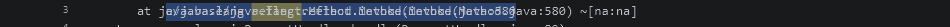
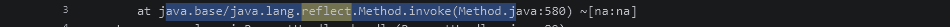

# Perbaikan teks bertumpuk saat selection di log canvas

Tanggal: 20 Oktober 2026.

## Hasil

Selection kini mempertahankan bentuk dan posisi teks asli. Stack trace dengan tab tidak lagi mendapat lapisan substring pada posisi yang berbeda. Posisi mouse, batas selection, dan highlight pencarian menggunakan ukuran layout teks yang sama. Isi Copy tetap menggunakan string mentah, termasuk tab dan newline.

Perubahan produksi terbatas pada CanvasLogViewer. Tidak ada perubahan API publik, database, dependensi, atau token warna. Perbaikan ikon dan pencarian sebelumnya tetap dipertahankan.

## Before dan after

Fixture berisi log ERROR sintetis, exception, stack trace berindentasi tab/spasi, dan baris penyebab. Kedua fase menggunakan jendela 1100×330, font Consolas 13 px, scroll horizontal 0, serta drag dari indeks mentah 5 hingga 54 pada baris stack trace ketiga. Kata reflect disorot sebagai hasil pencarian. Input mouse dihitung dari posisi caret layout teks, bukan perkiraan jumlah karakter dikali lebar huruf.

### Light

Before, crop area selection:



After, crop area selection yang sama:



[Layar penuh before Light](assets/canvas-selection-fix/before-stack-trace-light.png) · [Layar penuh after Light](assets/canvas-selection-fix/after-stack-trace-light.png)

### Dark

Before:



After:



[Layar penuh before Dark](assets/canvas-selection-fix/before-stack-trace-dark.png) · [Layar penuh after Dark](assets/canvas-selection-fix/after-stack-trace-dark.png)

### Bukti terukur

| Pemeriksaan | Before | After |
| --- | --- | --- |
| Pixel berbeda terhadap referensi satu lapisan, Light | 2380 | 0 |
| Pixel berbeda terhadap referensi satu lapisan, Dark | 2380 | 0 |
| Copy pada stack trace berawalan tab | Rentang raw bergeser dari area yang ditunjuk | Tepat sama dengan substring indeks 5 sampai sebelum 54 |
| Akses tambahan ke sumber selama 34 gerakan drag di viewport yang sudah dicache | 68 pemanggilan accessor | 0 pemanggilan accessor |
| Redraw 12 kali setelah horizontal scroll 38.5 px | Referensi visual gagal | Referensi sesuai dan frame tidak berubah setelah redraw berulang |

Pengukuran pixel menggunakan referensi Canvas yang menggambar teks asli sekali dengan font, origin, background, highlight, dan viewport clip yang sama dalam JVM yang sama. Ini bukan perbandingan screenshot lintas mesin. Pengukuran accessor menggunakan LogEntry sintetis dengan counter; ini tidak mengukur throughput file atau jaringan.

## Reproduksi dan akar penyebab

1. Isi canvas dengan exception dan baris stack trace yang diawali tab.
2. Drag sebagian teks pada baris stack trace.
3. Aktifkan highlight pencarian yang beririsan dengan selection.
4. Periksa teks di dalam selection dan lakukan Copy.
5. Ulangi setelah scroll horizontal dan dengan drag balik lintas baris.

Renderer lama menggambar teks baris terlebih dahulu, lalu menggambar ulang substring terpilih pada posisi index × charWidth. Lebar tab tidak sama dengan satu huruf A yang dipakai sebagai unit ukuran. Akibatnya, substring kedua tidak sejajar dengan glyph aslinya. Penggambaran berulang juga menebalkan tepi glyph ketika posisi kebetulan sama. Hit-testing dengan perhitungan karakter tetap membuat rentang Copy bergeser pada baris bertab.

Tes awal pada baseline menghasilkan Total 5, Passed 0, Failed 5. Kegagalan yang diamati:

- selectedStackTraceMatchesOneTextPass: perbedaan glyph dan rentang Copy salah di Light/Dark.
- redrawAndHorizontalScrollDoNotAccumulateGlyphs: hasil selection setelah horizontal scroll tidak cocok dengan referensi.
- reverseAndMultilineDragKeepRawTabsAndNewlines: glyph hasil selection lintas baris tidak cocok dengan referensi.
- wholeLineSelectionUsesReadableTextWithNoSecondGlyphLayer: foreground satu baris terpilih tidak cocok dengan satu lapisan teks.
- draggingOverCachedLinesDoesNotReadTheSourceAgain: drag membaca ulang sumber yang sudah ada di viewport cache.

## Perbaikan

Renderer menggunakan teks asli dan origin yang sama saat membedakan foreground terpilih dan tidak terpilih. Untuk baris dengan warna level berbeda, area foreground dipisahkan dengan clip yang tidak saling menimpa. Jika seluruh teks terpilih atau warna foreground sudah sama, teks digambar sekali. Setiap clip lokal dipulihkan menggunakan save/restore dalam try/finally.

Layout Text dengan font yang sama dicache untuk baris viewport. caretShape menentukan batas selection serta highlight, sedangkan hitTest mengubah koordinat mouse menjadi indeks string mentah. Tab tidak diganti menjadi spasi pada data. Cache diinvalidasi saat buffer diganti atau viewport diperbarui, dan ringkasan selection memakai baris cache jika tersedia.

Background selection dan highlight pencarian tetap memakai token tema yang sudah ada. Warna level di luar selection tetap dipertahankan. Kontras foreground selection diuji minimal 4.5:1 pada Light/Dark, aktif maupun tidak aktif; ukuran font tetap minimal 13 px.

## Validasi akhir

Seluruh tes dijalankan headless melalui wrapper Gradle dengan --no-daemon. Hanya kelas terkait yang dijalankan, bukan full suite.

```powershell
.\gradlew.bat --no-daemon test --tests "com.seeloggyplus.shared.ui.canvas.CanvasSelectionRenderingRegressionTest" --tests "com.seeloggyplus.shared.ui.canvas.CanvasLogViewerInteractionTest" --tests "com.seeloggyplus.shared.ui.canvas.CanvasThemeTest" --tests "com.seeloggyplus.shared.ui.SelectionColorConsistencyTest"
```

| Kelas | Total | Passed | Failed |
| --- | ---: | ---: | ---: |
| CanvasSelectionRenderingRegressionTest | 8 | 8 | 0 |
| CanvasLogViewerInteractionTest | 24 | 24 | 0 |
| CanvasThemeTest | 4 | 4 | 0 |
| SelectionColorConsistencyTest | 3 | 3 | 0 |

Cakupan mencakup drag maju/balik dan lintas baris, selection seluruh baris, tab/spasi, karakter Latin beraksen dan CJK, highlight pencarian, Copy, perubahan fokus, resize, scroll horizontal, posisi scroll vertikal pecahan, redraw berulang, serta penambahan baris Tail.

Output aktual task testSummary:

```text
==================== TEST SUMMARY ====================
  Total   : 39
  Passed  : 39
  Failed  : 0
  Skipped : 0
  Result  : PASS
======================================================
```

Tidak ada tes gagal pada run akhir. Durasi Gradle 33s. Run sementara dengan 31 tes tidak digunakan sebagai hasil akhir: penulisan fixture Unicode sempat gagal karena encoding default Windows, file tes baru dipulihkan dengan UTF-8, dan delapan tes reproduksi kembali ikut dalam run akhir.

Smoke test dijalankan detached melalui runDev. Log mencatat SeeLoggyPlus application started successfully pada 20:33:01 waktu lokal. Skrip scripts/stop-app.ps1 dijalankan setelah pemeriksaan, dan run-dev.log dihapus. Pemeriksaan git diff --check lulus. Screenshot dan pemeriksaan selection berasal dari tes headless; smoke test ini memverifikasi startup aplikasi.

## Batas validasi

Data dan screenshot memakai log sintetis tanpa alamat atau isi server pengguna. Skenario selection diuji pada canvas dengan buffer Tail sintetis; koneksi SSH nyata tidak diperlukan untuk mereproduksi cacat rendering. Pengujian Unicode mencakup Latin beraksen dan CJK, bukan seluruh kombinasi tulisan dua arah atau grapheme kompleks.

Tes visual membandingkan hasil render pada font dan lingkungan yang sama. Bentuk antialias dapat berbeda pada mesin lain; nilai pixel dalam laporan bukan golden image lintas platform. Tidak dilakukan commit dan tidak dijalankan full regression suite.
