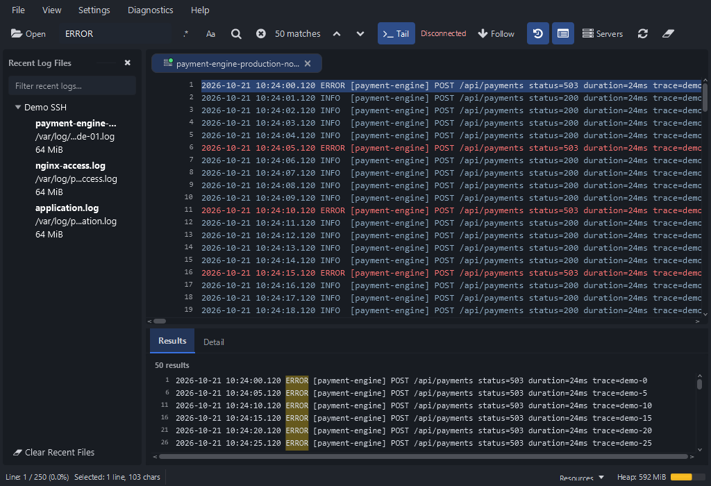
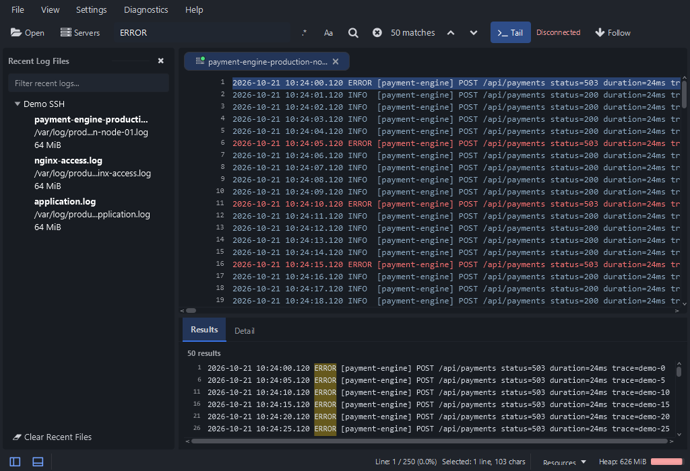
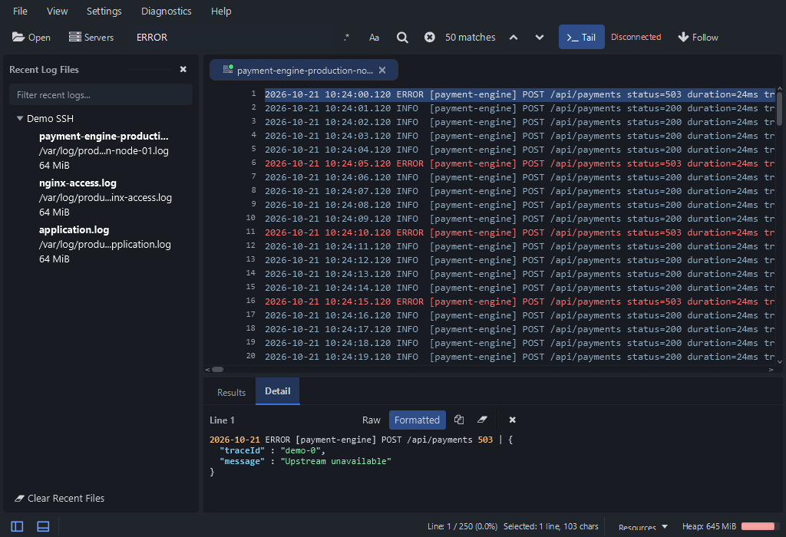

# Revisi bottom bar, grouping toolbar, dan Raw / Formatted

Tanggal: 21 Oktober 2026.

## Hasil perubahan

| Bagian | Sebelum | Sesudah |
| --- | --- | --- |
| Kontrol panel | History/List di toolbar atas | Dua ikon outline posisi panel di ujung kiri bottom bar, tanpa label Recent/Detail |
| Status ikon | Tombol toolbar dengan bidang selected | Bar rata; stroke aksen ketika aktif, tooltip Ctrl+B/Ctrl+J, serta focus ring keyboard |
| Informasi baris | Di kiri status bar | Di kanan bersama selection dan resource; pemisah tipis setelah ikon panel |
| Toolbar | Aksi panel, file, search, Tail, Reload dan Clear tercampur | Tiga kelompok: Open/Servers, Search, Tail/Follow |
| Lebar sempit | Label aksi dapat terpotong | Open/Servers sengaja menjadi ikon pada toolbar di bawah 1000 px; tooltip dan accessible text tetap ada. Tail/Follow tetap berlabel; overflow native tersedia |
| Reload / Clear | Tombol tersendiri di toolbar | Menu tab: Reload / Clear Log View. F5 dan View > Refresh tetap tersedia; File > Clear Log View juga tersedia |
| Formatted | Memerlukan toggle JSON/XML terlebih dahulu | Langsung mendeteksi payload JSON/XML tanpa toggle tambahan |
| Teks biasa / rusak | Formatted dapat aktif tanpa perubahan | Formatted nonaktif dengan tooltip penjelasan; Raw tetap utuh |
| Pengaturan otomatis | Dua checkbox JSON dan XML | Satu pilihan membuka Detail dalam Formatted mode |

Bottom toggle tetap mengendalikan Detail. Saat Results dan Detail berbagi dock bawah, menutup Detail tetap menyisakan Results. Tombol Close panel, menu View, serta shortcut tetap sinkron dengan ikon.

## Screenshot

Fixture yang sama: 250 baris sintetis, 50 hasil ERROR, tiga Recent Files demo, dan selection baris pertama. Baseline adalah capture redesign sebelumnya; hasil terbaru dibuat dengan Monocle/software renderer pada empat ukuran dan kedua tema.

### Bottom bar dan toolbar

Before, dark 1024x700:

After, dark 1024x700:

[Light 800x600](assets/chrome-revision/after/light-800x600.png) memperlihatkan ikon Open/Servers pada lebar sempit. Ikon bottom bar tetap tanpa label.

### Raw dan Formatted langsung

[Raw dark](assets/chrome-revision/after/dark-detail-raw.png) / [Formatted dark](assets/chrome-revision/after/dark-detail-formatted.png).

[Raw light](assets/chrome-revision/after/light-detail-raw.png) / [Formatted light](assets/chrome-revision/after/light-detail-formatted.png).

Angka heap pada gambar berasal dari JVM pengujian dan tidak dipakai sebagai perbandingan resource.

## Perilaku format dan kompatibilitas

- Raw menampilkan dan menyalin isi asli; Formatted menyalin tampilan yang sudah dirapikan. Prefix/suffix log tetap dipertahankan.
- Mode yang dipilih berlaku untuk baris berikutnya. Jika suatu baris tidak mendukung formatting, tampilannya Raw; pilihan Formatted sebelumnya kembali berlaku saat payload yang sesuai dipilih.
- Payload besar diperiksa dan diformat di background menggunakan satu worker dan satu slot pending. Generation guard menjaga job lama agar tidak menimpa selection baru atau mengisi kembali panel yang sudah dibersihkan.
- Format mendukung payload object/array JSON dan XML yang dapat diparse. XML dengan deklarasi DTD/entity tidak diproses oleh deteksi otomatis.
- Preferensi baru `main_detail_formatted` memakai preferensi JSON/XML lama sebagai fallback: jika salah satu aktif, default Formatted aktif. Nilai baru yang sudah disimpan mendapat prioritas. Tidak ada perubahan schema atau penghapusan data preferensi lama.
- API detail `setDefaultFormatted(boolean)` menggantikan pengaturan dua format dan callback toggle yang sudah tidak digunakan. Pemanggil aplikasi, tes, dan generator screenshot ikut diperbarui.

## Validasi

**142/142 tes lulus pada 19 kelas terkait**, tanpa failed/skipped.

Daftar kelas dan jumlah per kelas tersedia di [selected-tests.json](assets/chrome-revision/selected-tests.json). Semua tes headless; full regression suite tidak dijalankan.

Cakupan: posisi/ukuran/kontras ikon footer pada 600/800/1024 px dan kedua tema, grouping tiga bagian, docking dan state panel, format JSON/XML tanpa prasyarat, payload rusak, clipboard dua mode, job formatting lama, preferensi lama/baru, Clear pada tab yang dituju, FXML, dan navigasi menu.

Ambang kontras ikon 3:1 serta teks 4,5:1 dipertahankan. Tes sudut panel memakai toleransi satu nilai kanal 8-bit untuk rasterisasi koordinat pecahan; tes focus ring memakai kontrol yang enabled agar menguji interaksi keyboard yang sebenarnya.

[Smoke startup](assets/chrome-revision/smoke.json) mencatat peluncuran detached, hasil startup/FXML, penghentian aplikasi, dan cleanup log root. Capture headless memeriksa visual; smoke native memeriksa startup.

Bukti geometry lengkap: [before](assets/chrome-revision/before/metrics.json) / [after](assets/chrome-revision/after/metrics.json). Direktori aset berisi delapan pasangan screenshot utama dan empat screenshot tambahan mode Detail.

### Kelas tes terkait

| Kelas | Passed |
| --- | ---: |
| `com.seeloggyplus.app.ButtonThemeTest` | 6 |
| `com.seeloggyplus.app.CompactActionButtonsTest` | 3 |
| `com.seeloggyplus.app.IconContrastTest` | 4 |
| `com.seeloggyplus.app.LabelContrastTest` | 3 |
| `com.seeloggyplus.app.MainControllerReachableFlowsTest` | 29 |
| `com.seeloggyplus.app.MainViewCompactLayoutTest` | 6 |
| `com.seeloggyplus.app.MainViewFxmlLoadTest` | 18 |
| `com.seeloggyplus.app.MainViewIconsTest` | 4 |
| `com.seeloggyplus.app.MainViewIslandLayoutTest` | 5 |
| `com.seeloggyplus.app.PreferencesDialogControllerTest` | 14 |
| `com.seeloggyplus.app.SettingsLayoutTest` | 2 |
| `com.seeloggyplus.app.ThemeComponentParityTest` | 6 |
| `com.seeloggyplus.app.WorkbenchCaptureTest` | 1 |
| `com.seeloggyplus.app.WorkbenchChromeRevisionTest` | 7 |
| `com.seeloggyplus.app.WorkbenchLayoutTest` | 7 |
| `com.seeloggyplus.features.detail.presentation.DetailPanelThemeTest` | 5 |
| `com.seeloggyplus.features.detail.presentation.LogDetailPaneAsyncCoverageTest` | 7 |
| `com.seeloggyplus.features.detail.presentation.LogDetailPaneControllerTest` | 12 |
| `com.seeloggyplus.shared.util.ThemeTokensTest` | 3 |
