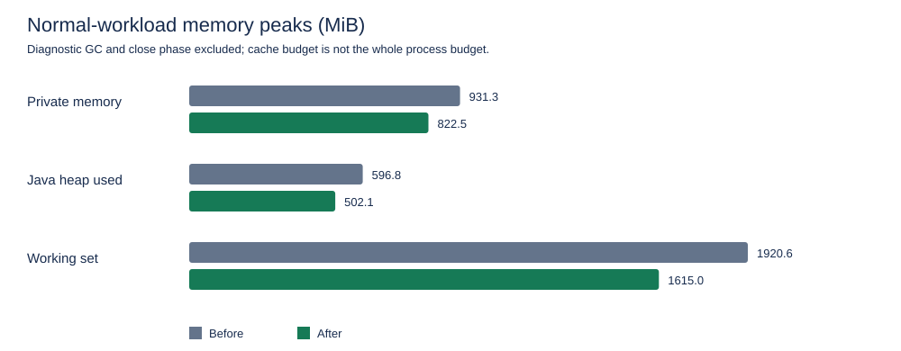

# SeeLoggyPlus — audit RAM dan performance

Tanggal pengukuran: 20 Oktober 2026. Laporan final: 21 Oktober 2026. Status: implementasi tervalidasi pada tes terkait; sebagian target performance belum tercapai.

Laporan membandingkan snapshot sebelum optimasi dengan snapshot sesudah optimasi pada workstation yang sama. Hasil final dan regresi yang terukur dilaporkan di bawah.

## Ruang lingkup dan cara membaca angka

- JavaFX 21 headless Monocle, software renderer; satu canvas aktif 1024 × 700 dan lima sesi Tail sintetis.
- JDK GraalVM 21.0.8 yang sama, G1, `-Xms128m -Xmx4g`, Native Memory Tracking summary dan JFR profile. Flag ini hanya untuk proses benchmark.
- File UTF-8 100 MiB, 512 MiB, dan 1 GiB; setiap baris 1024 byte termasuk newline. File dan checksum yang sama tersedia sebelum kedua run utama dimulai.
- Indexing dan setiap query mempunyai satu warmup serta lima pengulangan terukur. Query mencakup literal tanpa hasil, jarang cocok, semua cocok, regex, dan boolean.
- Lima sesi menyimpan masing-masing 50.000 baris. Producer menargetkan 100 baris per 100 ms per sesi, sekitar 1 KiB per baris, selama 1800 detik. Laju aktual dihitung dari jumlah tick, bukan diasumsikan tepat 5.000 baris/detik.
- Heartbeat FX dicatat pada 1 Hz. Angkanya mengukur waktu antre event, bukan FPS, durasi frame, atau waktu input sampai terlihat di monitor.
- Search kernel mengukur scan dan pembuatan hasil per chunk dengan 2/4/6 worker. Angka ini bukan waktu pencarian end-to-end seluruh MainController.
- Sesi Tail memakai replay sintetis pada penyimpanan sesi; benchmark tidak mengukur jaringan SSH atau server pengguna. Alur SSH/UI diperiksa lewat tes terkait.
- Histogram kelas merupakan live shallow heap sesudah GC diagnostik, bukan dominator tree. GC diagnostik dijalankan sesudah soak, bukan untuk memperkecil angka peak normal.
- Proses berjalan di workstation pengguna, bukan mesin benchmark yang diisolasi. Sebagian run, tes, dan smoke berlangsung berdekatan. Hasil ini bukan SLA untuk hardware lain.

Run `before-initial` ikut membuat fixture, sehingga dikeluarkan dari tabel perbandingan utama. Run after yang dihentikan selama iterasi juga dikeluarkan. Perbandingan final memakai direktori `before` dan `after` dengan fixture yang sudah tersedia. Snapshot compiled class tetap dibekukan sepanjang pengukuran.

## Hasil final before / after

Dua soak 30 menit selesai pada 20 Oktober 2026, pukul 22:19 dan 22:40 waktu lokal. Mesin: Ryzen 5 6600H, 6 core/12 logical processor, RAM terlihat 13,75 GiB, Windows 11 Pro. Tidak ada pengurangan batas konten 50.000 baris/sesi atau perubahan heap launcher produksi.

**Kesimpulan penerimaan: implementasi dan tes terkait selesai, tetapi seluruh target performance belum terpenuhi.** Peak private memory turun 11,68%, di bawah target 20%; beberapa scan dan indexing lebih lambat. Angka live heap sesudah GC tidak boleh dipakai menggantikan peak proses untuk mengklaim target tercapai.

| Resource / metrik | Before | After | Perubahan |
| --- | ---: | ---: | ---: |
| Peak private memory (MiB) | 931.31 | 822.52 | -11.68% |
| Peak Java heap used (MiB) | 596.77 | 502.09 | -15.87% |
| Peak heap committed (MiB) | 708.00 | 590.00 | -16.67% |
| Peak working set (MiB) | 1920.62 | 1614.98 | -15.91% |
| Live shallow heap sesudah GC (MiB) | 329.12 | 91.18 | -72.30% |
| Live shallow heap setelah close + GC (MiB) | 34.31 | 34.17 | -0.38% |
| CPU rata-rata proses / kapasitas mesin | 1.08% | 1.29% | naik |
| Tail sintetis aktual (baris/detik, 5 sesi) | 4696.39 | 4961.11 | +5.64% |
| FX event delay p95 / p99 (ms) | 0.1010 / 0.2546 | 0.1185 / 0.2930 | keduanya di bawah batas |



Peak berasal dari sampling satu detik pada fase normal, termasuk indexing/search dan Tail, tanpa close atau GC diagnostik. Puncak sangat singkat di antara sampel dapat terlewat. Kedua sampler selesai tanpa error. CPU memakai kapasitas 12 logical processor sebagai 100%.

### Bagian RAM paling besar

Histogram saat lima sesi penuh menunjukkan sumber utama sebelum optimasi adalah `byte[]`, yang mencakup payload String. Ini atribusi kelas, bukan bukti seluruh array tersebut dimiliki Tail. Sesudah optimasi, payload berkurang dan descriptor spool menjadi biaya yang lebih terlihat.

| Kelas / kelompok, live shallow MiB | Before | After |
| --- | ---: | ---: |
| byte[] | 260.02 | 27.18 |
| LogEntry | 15.26 | 0.93 |
| HashMap | 11.56 | 0.11 |
| Descriptor spool Record | 0.00 | 24.80 |
| int[] | 14.09 | 14.09 |
| long[] | 12.94 | 12.94 |

Seluruh `long[]` hanya 3,93% dari live heap baseline; line index adalah sebagian darinya. Karena batas atas kontribusinya di bawah 10%, perubahan format indeks ditunda. Kapasitas awal builder tetap diperbaiki. Setelah close, live heap kembali sekitar 34 MiB pada kedua versi; private committed memory JVM tidak harus langsung turun sebesar objek yang sudah bebas.

### Search kernel: file 1 GiB

Median lima run setelah satu warmup. Alokasi dihitung pada worker scan, termasuk hasil chunk, tidak mencakup seluruh UI atau tahap merge. Tabel utama menggunakan enam worker pada kedua versi supaya perubahan algoritma dapat dibandingkan. Default lama 12 logical processor belum dibenchmark langsung terhadap default baru enam; hasil ini tidak membuktikan speedup default end-to-end.

| Query | Before ms | After ms | Perubahan waktu | Before alokasi MiB | After alokasi MiB |
| --- | ---: | ---: | ---: | ---: | ---: |
| `ABSENT_MARKER` | 405.89 | 484.89 | +19.46% | 3120.0003 | 0.0000 |
| `ERROR` | 405.32 | 480.80 | +18.62% | 3120.1283 | 0.0935 |
| `2026` | 457.43 | 180.95 | -60.44% | 3136.4887 | 8.0379 |

Query tanpa hasil dan jarang cocok lebih lambat pada run final, sedangkan query semua cocok lebih cepat. Pengurangan alokasi mencapai setidaknya 99,74%, tetapi target throughput per query belum lulus. Kontensi workstation/run yang bertumpang tindih membatasi kesimpulan kausal; angka yang buruk tetap disertakan.

| Worker | Before jumlah median 3 query (ms) | After jumlah median 3 query (ms) |
| --- | ---: | ---: |
| 2 | 2607.35 | 2667.04 |
| 4 | 1575.52 | 1617.30 |
| 6 | 1268.64 | 1146.64 |

Enam worker mempunyai jumlah median terbaik dari 2/4/6 pada kedua versi. Pengaturan ini menyisakan kapasitas bagi UI/background, tetapi bukan hasil tuning universal.

### Indexing dan query lain

Median lima run pada harness utama. Literal pada harness utama memakai akses reflection pada jalur baru, sehingga tabel kernel di atas merupakan pembanding utama untuk literal. Regex/boolean tetap dicatat di sini.

| Operasi | Before ms | After ms | Perubahan waktu |
| --- | ---: | ---: | ---: |
| `index:100` | 51.71 | 87.88 | +69.94% |
| `index:512` | 245.24 | 408.76 | +66.68% |
| `index:1024` | 415.16 | 844.32 | +103.38% |
| `search:ERROR.*synthetic:1024` | 1874.45 | 1782.66 | -4.90% |
| `search:POST AND NOT skip:1024` | 1932.04 | 1780.30 | -7.85% |

Burst eksploratif 5.000 × 128 KiB: 351.90 → 1014.70 ms (+188.35% waktu). Snapshot heap sebelum diagnostic GC: 863.13 → 121.63 MiB. Semua 50 sampel konten diverifikasi lengkap; ini bukan verifikasi isi seluruh 5.000 baris. Penulisan spool mengurangi heap dengan biaya disk; target throughput burst gagal. Ini satu pengulangan eksploratif, bukan estimasi statistik.

JFR seluruh rekaman, termasuk diagnostic GC: jumlah pause 842 → 542; total pause 2,31 → 1,58 detik; p99 12,7 → 6,27 ms; maksimum 34,4 → 30,5 ms. Median pause naik 0,748 → 3,96 ms. Data ini bukan metrik GC fase normal saja.

### Status target dan prioritas berikutnya

| Target | Hasil | Status |
| --- | --- | --- |
| Peak private memory turun ≥20% | turun 11,68% | belum tercapai |
| Alokasi literal turun ≥40% | turun ≥99,74% pada kernel | tercapai |
| Throughput setiap operasi tidak turun >5% | scan absent/rare, indexing dan burst regresi | belum tercapai |
| FX event p95 ≤50 ms, p99 ≤100 ms | 0,1185 / 0,2930 ms pada model headless | tercapai untuk model ini |
| Riwayat/search tetap lengkap | retention tetap, tes fungsional lulus | tercapai dalam cakupan tes |

Prioritas lanjutan berdasarkan bukti:

1. Ulangi indexing dan scan absent/rare secara berurutan pada host idle, termasuk default lama 12 vs baru 6 worker. Pisahkan waktu baca, scan ASCII, pembentukan hasil, dan GC sebelum menetapkan penyebab regresi. Jangan mengklaim target throughput sudah selesai.
2. Optimalkan append burst melalui batching write dan pengukuran lock/flush spool; pertahankan backpressure serta urutan baris. Tambahkan pengulangan burst sebelum memilih perubahan.
3. Ukur dominator heap dan NMT pada private-memory peak untuk menjelaskan selisih live heap vs committed process; fokuskan anggaran pada descriptor/cache/heap commitment yang terbukti, tanpa mengurangi isi log atau sekadar menurunkan Xmx.
4. Tambahkan pembersihan spool crash berbasis kepemilikan/lease proses dan uji recovery; lanjutkan validasi native JavaFX serta SSH nyata.

## Bukti dan hasil validasi

205 tes pada 22 kelas terkait lulus, tanpa failed/skipped. Ini selected tests, bukan full suite. Smoke aplikasi final berhasil diluncurkan detached, FXML berhasil dimuat, aplikasi dihentikan memakai `scripts/stop-app.ps1`, dan log root dibersihkan.

| Kelas terkait | Passed |
| --- | ---: |
| `com.seeloggyplus.app.CanvasSearchFilteringTest` | 4 |
| `com.seeloggyplus.app.FileManagerTailModeEndToEndTest` | 20 |
| `com.seeloggyplus.app.SearchFeatureE2ETest` | 5 |
| `com.seeloggyplus.app.SearchResultsRegressionTest` | 13 |
| `com.seeloggyplus.app.TailEnableDisableLogDisplayTest` | 5 |
| `com.seeloggyplus.app.TailTransitionAndRecentSyncTest` | 14 |
| `com.seeloggyplus.features.detail.presentation.DetailPanelThemeTest` | 5 |
| `com.seeloggyplus.features.detail.presentation.LogDetailPaneAsyncCoverageTest` | 7 |
| `com.seeloggyplus.features.detail.presentation.LogDetailPaneControllerTest` | 11 |
| `com.seeloggyplus.features.logs.infrastructure.io.SpoolingTailHistoryTest` | 3 |
| `com.seeloggyplus.features.search.presentation.SearchPanelThemeTest` | 6 |
| `com.seeloggyplus.features.search.presentation.SearchResultPanelBehaviorTest` | 20 |
| `com.seeloggyplus.shared.model.LogEntryTest` | 13 |
| `com.seeloggyplus.shared.session.LogSessionTest` | 6 |
| `com.seeloggyplus.shared.ui.canvas.CanvasLogViewerInteractionTest` | 29 |
| `com.seeloggyplus.shared.ui.canvas.CanvasLogViewerStateBehaviorTest` | 21 |
| `com.seeloggyplus.shared.ui.canvas.CanvasSelectionRenderingRegressionTest` | 8 |
| `com.seeloggyplus.shared.ui.canvas.CanvasThemeTest` | 4 |
| `com.seeloggyplus.shared.util.IntArrayListTransferTest` | 1 |
| `com.seeloggyplus.shared.util.LineOffsetIndexAllocationTest` | 1 |
| `com.seeloggyplus.shared.util.MappedFileReaderTest` | 7 |
| `com.seeloggyplus.shared.util.ReaderAllocationTest` | 2 |

Bukti kecil disimpan di [direktori aset](assets/performance-audit/): [summary](assets/performance-audit/summary.json), [before CSV](assets/performance-audit/before/samples.csv), [after CSV](assets/performance-audit/after/samples.csv), result/kernel/burst JSON, histogram, NMT, alokasi JFR, GC, host, checksum fixture, manifest sumber, selected tests, dan smoke. Snapshot after diverifikasi terhadap 170 file sumber tanpa perbedaan. Baseline menyertakan perbaikan UI/search/selection sebelumnya, sehingga pembanding hanya perubahan performance saat ini.

Rekaman besar tetap lokal dan diabaikan Git: [before JFR](../../build/performance/before/profile.jfr), [after JFR](../../build/performance/after/profile.jfr). Snapshot compiled class dan fixture juga berada di `build/performance`; aset laporan tidak cukup untuk merekonstruksi binary baseline jika direktori build dihapus.

## Temuan dan perbaikan

| Area | Sebelum | Perbaikan yang diterapkan |
| --- | --- | --- |
| Riwayat Tail | Semua raw string dan LogEntry ditahan di heap sampai 50.000 baris per sesi | Riwayat ditulis ke segmen file sementara 4 MiB; metadata tetap di memori; cache decoded content berbatas 8 MiB/sesi dan 32 MiB global |
| Antrean Tail | Batas 5.000 entri membuang baris tertua ketika penuh | Backpressure producer; anggaran antrean 4 MiB dan maksimum 5.000 entri; publikasi UI maksimal 500 baris per batch |
| Pemotongan riwayat | Penggeseran ArrayList berulang pada setiap trim | Head offset dan kompaksi berkala; segmen tanpa referensi dibersihkan |
| Field LogEntry | Raw entry mengalokasikan HashMap kosong | Empty map dibagi sampai mutasi pertama; defensive copy accessor tetap berlaku |
| Membaca baris file | Byte buffer baru untuk setiap read | Scratch buffer per worker, maksimum 256 KiB; bulk copy dari mapped buffer |
| Literal search | Decode String dan lowercase setiap baris | Jalur UTF-8/ASCII tanpa String sementara; fallback Unicode/charset/locale mempertahankan perilaku lama |
| Indeks baris | Estimasi awal file/100 mengalokasikan terlalu besar untuk log panjang | Kapasitas awal builder dibatasi 65.536 offset; format offset 64-bit tetap dipakai |
| Hasil pencarian | Penggabungan menyalin semua indeks; preview cache hanya dibatasi jumlah entri | Blok integer dapat dipindahkan kepemilikannya; preview maksimal 256 entri dan estimasi 8 MiB; maksimal empat load bersamaan |
| Canvas | Glyph layout dibuat lagi untuk semua baris saat scroll | Layout baris overlap dipakai ulang; cold Tail dimuat di background dan redraw dikoaleskan ke pulse |
| Selection/copy/count Tail | Cold disk history berpotensi dibaca saat event UI | Aktivasi baris, copy snapshot, hit counting, dan incremental search membaca data di background; summary selection memakai metadata panjang baris |
| Search saat trim | Posisi hasil dapat bergeser ketika riwayat dipangkas selama scan | Snapshot membawa base index; hasil direbase sebelum dipasang dan scan incremental mengejar baris berikutnya |
| Detail besar | Job formatting lama dapat menumpuk dan menimpa state baru | Satu worker dan satu slot pending; job sebelumnya dibatalkan; generation diperiksa kembali pada thread FX |
| Lifecycle | Cache teks/glyph masih dapat tertahan setelah reset | Reset melepaskan array teks/layout; close sesi menutup spool, membuang cache, dan melepas snapshot |
| Paralelisme | Mengikuti seluruh logical processor | Enam worker dipilih dari benchmark 2/4/6; dapat dituning lewat `seeloggyplus.searchWorkers` |

Anggaran cache bukan batas seluruh RAM aplikasi. Descriptor riwayat, viewport/glyph layout, hasil search, heap JVM, native memory, serta halaman mapped file mempunyai biaya tersendiri. Anggaran antrean mengizinkan satu baris yang melebihi anggaran ketika antrean kosong agar baris itu tidak dibuang. Snapshot search/copy dapat mempertahankan segmen lama sampai selesai atau dibatalkan.

## Validasi fungsional

Selected tests mencakup reader/index allocation, transfer indeks hasil, field model, sesi dan spool, search/UI/Tail end-to-end, detail async, selection rendering, serta tema/kontras. Tes tetap headless. Daftar kelas dan jumlah per kelas disimpan bersama hasil pengukuran.

Kasus yang diverifikasi mencakup antrean 5.100 baris tanpa kehilangan row pertama, cache global lintas lima sesi, Unicode/Turkish locale/chunk boundary, cold baris yang melebihi anggaran cache, copy/aktivasi/count/search tanpa disk read pada thread FX, rebasing hasil ketika trim berlangsung, serta pembersihan spool setelah close. Full regression suite tidak dijalankan pada pekerjaan fitur ini.

## Melihat pemakaian RAM dan alokasi

Untuk melihat proses tertentu dari PowerShell:

```powershell
Get-Process -Id $profileProcessId | Select-Object Id, WorkingSet64, PrivateMemorySize64
& "$javaHome/bin/jcmd.exe" $profileProcessId GC.heap_info
& "$javaHome/bin/jcmd.exe" $profileProcessId VM.native_memory summary
```

`WorkingSet64` menunjukkan halaman resident proses, termasuk mapped file. `PrivateMemorySize64` adalah private committed memory. Heap used adalah objek Java yang sedang dialokasikan; heap committed dapat lebih besar. Ketiganya tidak dapat dijumlahkan dan tidak saling menggantikan.

Untuk menemukan lokasi alokasi dan melihat GC dari rekaman:

```powershell
& "$javaHome/bin/jfr.exe" view --width 180 allocation-by-site build/performance/after/profile.jfr
& "$javaHome/bin/jfr.exe" view --width 180 allocation-by-class build/performance/after/profile.jfr
& "$javaHome/bin/jfr.exe" view gc-pauses build/performance/after/profile.jfr
```

`GC.class_histogram` memicu GC diagnostik. Gunakan histogram untuk atribusi live object; gunakan CSV sampling untuk peak normal. Rekaman juga dapat dibuka dengan Java Mission Control.

## Reproduksi

```powershell
& ./scripts/profile-performance.ps1 -Phase before -Kind soak -SoakSeconds 1800 -JavaHome $javaHome
& ./scripts/profile-performance.ps1 -Phase after -Kind soak -SoakSeconds 1800 -JavaHome $javaHome
& ./scripts/profile-performance.ps1 -Phase before -Kind kernel -JavaHome $javaHome
& ./scripts/profile-performance.ps1 -Phase after -Kind kernel -JavaHome $javaHome
python scripts/analyze-performance.py
```

Script meluncurkan proses secara detached dan mengembalikan PID serta lokasi output. Tunggu setiap pengukuran selesai sebelum memakai hasilnya. Snapshot `baseline` harus dibuat sebelum perubahan, sedangkan snapshot `optimized` berisi kode sesudah perubahan. Script tidak menimpa hasil yang sudah selesai. Fixture harus sudah tersedia untuk kedua run yang dibandingkan. Run pertama yang sekaligus membuat fixture hanya menjadi persiapan.

## Batas hasil dan tindak lanjut

- Burst 5.000 baris × 128 KiB memerlukan penulisan sekitar 625 MiB ke disk. Target agar throughput tidak turun lebih dari 5% harus dinilai terpisah; hasil lebih lambat tetap dilaporkan.
- Angka burst `heapUsedBeforeDiagnosticGc` adalah satu snapshot sebelum GC, bukan peak atau retained heap, dan hanya satu pengulangan eksploratif.
- Hot cache berbatas byte; metadata dan viewport tetap diperlukan untuk menjaga isi log lengkap. History retention tetap 50.000 baris per sesi.
- Close normal membersihkan spool. Force-kill/crash dapat meninggalkan file sementara; janitor berbasis lease/PID belum diterapkan.
- Spool dari sebagian run profiling yang dihentikan masih ada. Pembersihan otomatis, termasuk percobaan nonrekursif pada file terverifikasi, ditolak dengan alasan `blocked by policy`. Inventaris verifikasi tersimpan pada `build/performance/verified-partial-spools.json`.
- Kompaksi format line index hanya layak bila indeks menjadi kontributor besar pada workload terukur. Builder allocation dikurangi tanpa mengganti format offset.
- Pengukuran FPS/native renderer, SSH jaringan nyata, dan log yang sangat pendek per baris merupakan workload lanjutan yang berbeda dari replay ini.
