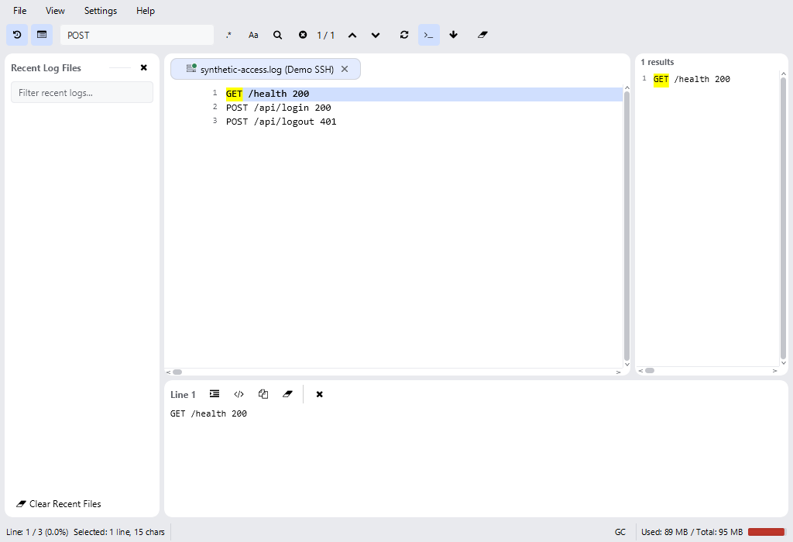
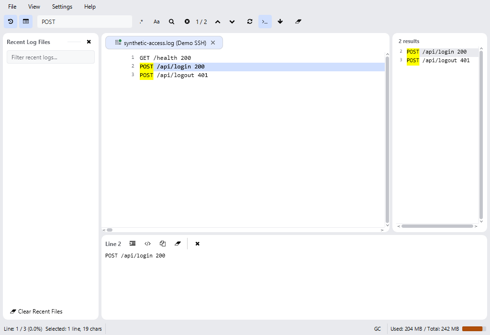
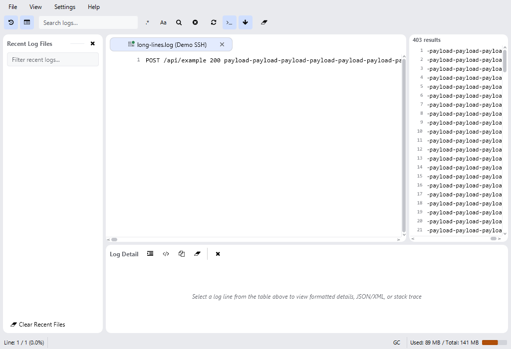
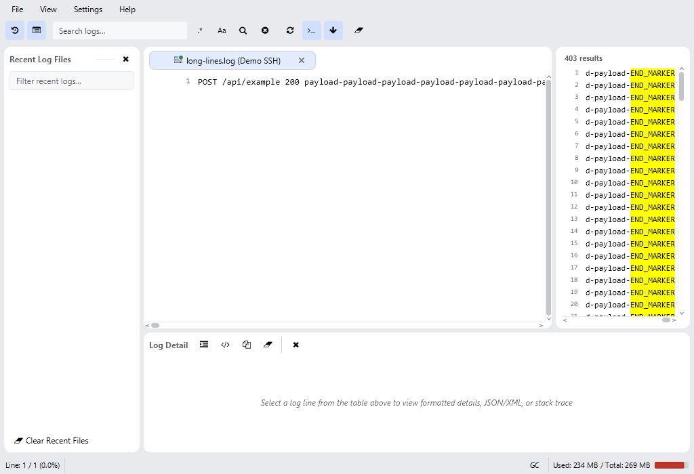

# Perbaikan panel hasil dan pencarian log

Tanggal: 20 Oktober 2026.

## Ringkasan

Panel hasil kini mempertahankan isi baris panjang, menyediakan rentang scroll berdasarkan teks yang dimuat, dan menjaga kontrol scroll di dalam clip panel. Pencarian normal dan Tail memvalidasi query, sesi, serta sumber sebelum menerapkan hasil. Log utama tetap menampilkan seluruh baris; kecocokan ditandai dengan highlight dan ditampilkan di panel hasil.

Perubahan ikon yang sebelumnya dikerjakan tetap dipertahankan. Tidak ada perubahan database, dependensi, atau kontrak log bersama.

## Before dan after

Bukti memakai data sintetis, tema Light, jendela 1024×700, panel Recent dan Detail terbuka, serta divider awal 75:25. Screenshot dihasilkan oleh harness yang sama, sebelum dan setelah perubahan produksi. Angka penggunaan memori pada status bar bukan benchmark.

| Skenario | Before | After |
| --- | --- | --- |
| GET lama selesai setelah pencarian POST baru | Input tetap POST, tetapi panel berisi 1 hasil GET dan highlight GET | Input POST, 2 hasil POST, highlight POST; seluruh 3 baris tetap terlihat di log utama |
| Baris hasil sepanjang 831 karakter | Isi dipangkas menjadi 500 karakter; END_MARKER tidak dapat dijangkau | Seluruh 831 karakter dipertahankan; END_MARKER dapat digeser ke viewport dan disorot |
| Scrollbar pada panel bersudut membulat | Sudut kontrol horizontal berada di luar bentuk clip; tes menemukan titik 2.5,363.5 terpotong | Padding memberikan ruang untuk kontrol; pemeriksaan seluruh sudut scrollbar lulus |
| Clear saat pencarian Tail berjalan | Callback lama mengembalikan hasil setelah Clear | Pekerjaan dibatalkan dan callback usang diabaikan |
| Berpindah tab saat pencarian berjalan | Hasil tab lama dapat diberikan kepada tab aktif yang baru | Hasil harus cocok dengan identitas sesi dan sumber; tab lain tidak menerima hasil lama |
| Kembali ke tab dengan query belum selesai | Teks query dipulihkan, tetapi pencariannya tidak dijalankan | Query yang belum mempunyai hasil dijalankan kembali |
| Regex tidak valid | Hanya tercatat di log; tidak ada feedback pencarian yang jelas | Status menampilkan Invalid regular expression beserta detail pada tooltip |
| Tail awalnya tidak memiliki kecocokan | Panel kosong tidak terisi ketika kecocokan pertama masuk | Hasil dan jumlah kecocokan diperbarui saat baris Tail baru masuk |

### Pencarian POST

Langkah reproduksi: buka sesi sintetis dengan GET /health, POST /api/login, dan POST /api/logout. Tahan pembacaan pencarian GET menggunakan latch, jalankan POST, kemudian lepaskan GET. Pengaturan waktu deterministik ini menguji callback lama tanpa bergantung pada kecepatan komputer atau jaringan.

Before:



After:



### Isi hasil panjang dan scrollbar

Fixture panel memuat 403 indeks hasil dengan isi baris sintetis berulang sepanjang 831 karakter. Scroll horizontal digeser ke batas kanan. Ini fixture layout panel; alur pencarian file lokal dan isi Detail lengkap diuji terpisah.

Before:



After:



## Akar penyebab dan perbaikan

### Layout dan konten

SearchResultPanel memangkas setiap string ke 500 karakter. Rentang horizontal juga memakai angka tetap 500, sehingga scrollbar tidak menggambarkan panjang konten. Padding 2 px menempatkan sudut scrollbar horizontal di luar clip bersudut membulat.

Pemangkasan tersebut dihapus. Rentang horizontal mengikuti panjang maksimum konten yang telah dimuat, diperbarui saat viewport berubah, dan offset dibatasi kembali ketika hasil berubah. Nomor baris tetap berada di gutter saat teks digeser. Padding panel menjadi 8 px agar kontrol tidak terpotong.

Isi hasil pada layar utama dimuat di background hanya ketika diperlukan, dengan cache maksimum 256 baris. Generation token membuang pemuatan konten yang sudah tidak relevan. Pemilihan nomor baris berlangsung langsung, sedangkan callback isi Detail menunggu konten lengkap. Pemisahan ini mempertahankan navigasi responsif tanpa membacakan hasil pada JavaFX Application Thread.

### Siklus pencarian

Jalur normal sebelumnya memiliki pemeriksaan generasi, tetapi worker membaca field sumber milik controller yang dapat berganti. Jalur Tail tidak memiliki pemeriksaan generasi atau identitas sesi pada callback selesai. Debounce juga bisa menjalankan ulang pencarian yang sudah dikirim melalui tombol atau Enter. Pemulihan tab hanya memulihkan teks jika pencarian belum sempat selesai.

Kedua jalur kini menggunakan snapshot sumber dan memvalidasi generasi, sesi aktif, status sesi, reader/index, serta mode Tail sebelum menerapkan hasil atau progres. Clear, input baru, pergantian sesi, reload, dan perubahan mode membatalkan pekerjaan yang tidak relevan. Query yang belum selesai dilanjutkan ketika tab diaktifkan kembali. Kesalahan pencarian ditampilkan sebagai status, bukan disamarkan sebagai nol kecocokan.

Panel mempertahankan referensi daftar hasil kosong sehingga kecocokan pertama dari Tail dapat disinkronkan. Tidak ada penyaringan log utama dalam perubahan ini.

Tambahan antarmuka terbatas pada komponen UI internal: overload resolver dengan executor, callback aktivasi baris sebelum konten dimuat, dan pesan status navigator. Helper pembacaan sinkron yang kehilangan pemakaian produksi beserta tes refleksi khusus helper tersebut dihapus; perilakunya dicakup oleh tes integrasi hasil/Detail lengkap dan tes resolver asynchronous.

## Pengujian

Tes reproduksi ditulis sebelum perubahan produksi. Run awal pada dua kelas menghasilkan Total 22, Passed 17, Failed 5, Skipped 0. Kegagalan membuktikan clipping scrollbar, hasil GET lama menimpa POST, Clear tidak membatalkan hasil Tail, dan pemangkasan baris panjang. Run terpisah pada baseline juga membuktikan regex tanpa feedback dan kebocoran hasil saat perpindahan tab. Tes tambahan kemudian menangkap kasus hasil Tail kosong, pemulihan query belum selesai, dan regresi navigasi asynchronous; semuanya diperbaiki.

Kelas terkait yang dijalankan pada validasi akhir:

- com.seeloggyplus.app.SearchResultsRegressionTest
- com.seeloggyplus.features.search.presentation.SearchResultPanelBehaviorTest
- com.seeloggyplus.features.search.presentation.SearchPanelThemeTest
- com.seeloggyplus.app.SearchFeatureE2ETest
- com.seeloggyplus.app.CanvasSearchFilteringTest
- com.seeloggyplus.app.MainControllerHelperLogicTest

Perintah:

```powershell
.\gradlew.bat --no-daemon test --tests "com.seeloggyplus.app.SearchResultsRegressionTest" --tests "com.seeloggyplus.features.search.presentation.SearchResultPanelBehaviorTest" --tests "com.seeloggyplus.features.search.presentation.SearchPanelThemeTest" --tests "com.seeloggyplus.app.SearchFeatureE2ETest" --tests "com.seeloggyplus.app.CanvasSearchFilteringTest" --tests "com.seeloggyplus.app.MainControllerHelperLogicTest"
```

Tes tetap headless. Cakupan meliputi ukuran 800×600, 1024×700, 1600×900; Light/Dark; bounds panel dan clip scrollbar; kontras header; highlight melewati karakter 500; isi Detail lengkap; literal, regex, case-sensitive, AND/OR/NOT; typing, Enter, tombol cari, Clear, perpindahan tab, nol hasil, dan penambahan baris Tail. Pemuatan asynchronous diperiksa terhadap thread, callback usang, dan batas cache.

Hasil validasi akhir, hanya enam kelas terkait (bukan full suite):

| Kelas | Total | Passed | Failed |
| --- | ---: | ---: | ---: |
| SearchResultsRegressionTest | 10 | 10 | 0 |
| SearchResultPanelBehaviorTest | 19 | 19 | 0 |
| SearchPanelThemeTest | 6 | 6 | 0 |
| SearchFeatureE2ETest | 5 | 5 | 0 |
| CanvasSearchFilteringTest | 4 | 4 | 0 |
| MainControllerHelperLogicTest | 20 | 20 | 0 |

Output aktual task testSummary:

```text
==================== TEST SUMMARY ====================
  Total   : 64
  Passed  : 64
  Failed  : 0
  Skipped : 0
  Result  : PASS
======================================================
```

Tidak ada nama tes gagal pada validasi akhir. Durasi run akhir Gradle: 1m 9s. Peringatan kompilasi unchecked/unsafe operations dari tes yang ada tetap muncul.

Smoke test dijalankan detached melalui runDev. Log mencatat SeeLoggyPlus application started successfully pada 20:15:21 waktu lokal. Skrip scripts/stop-app.ps1 dijalankan setelah pemeriksaan dan melaporkan tidak ada proses aplikasi yang masih berjalan. run-dev.log sudah dihapus. Pemeriksaan visual panel menggunakan screenshot headless di atas, bukan pengujian koneksi SSH nyata.

Pemeriksaan git diff --check juga lulus.

## Batas validasi

Sesi SSH/Tail diuji menggunakan data sintetis dan alur sesi aplikasi, tanpa koneksi ke server pengguna. Pencarian POST sederhana sudah lulus pada baseline; bukti yang gagal adalah kondisi balapan dan pemulihan sesi, bukan kegagalan semua pencarian POST. Langkah pengguna persis sebelum screenshot asli tidak diketahui, sehingga laporan tidak mengklaim seluruh kondisi lingkungan server telah direproduksi.

Batas reader yang sudah ada, MAX_LINE_BYTES 256 KiB per baris, tetap berlaku. Perbaikan ini menghapus batas tambahan 500 karakter pada panel. Rentang horizontal berkembang ketika baris baru dimuat; tidak dilakukan pemindaian seluruh hasil hanya untuk mengukur lebarnya.

Full suite tidak dijalankan karena pekerjaan ini merupakan perbaikan fitur. Tidak dilakukan commit.
