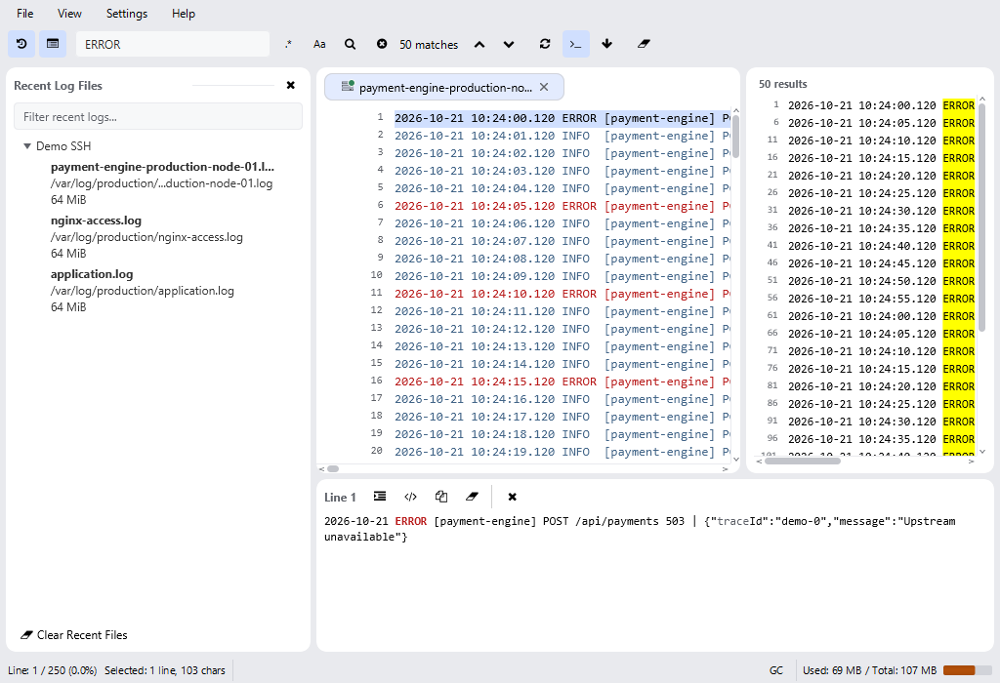
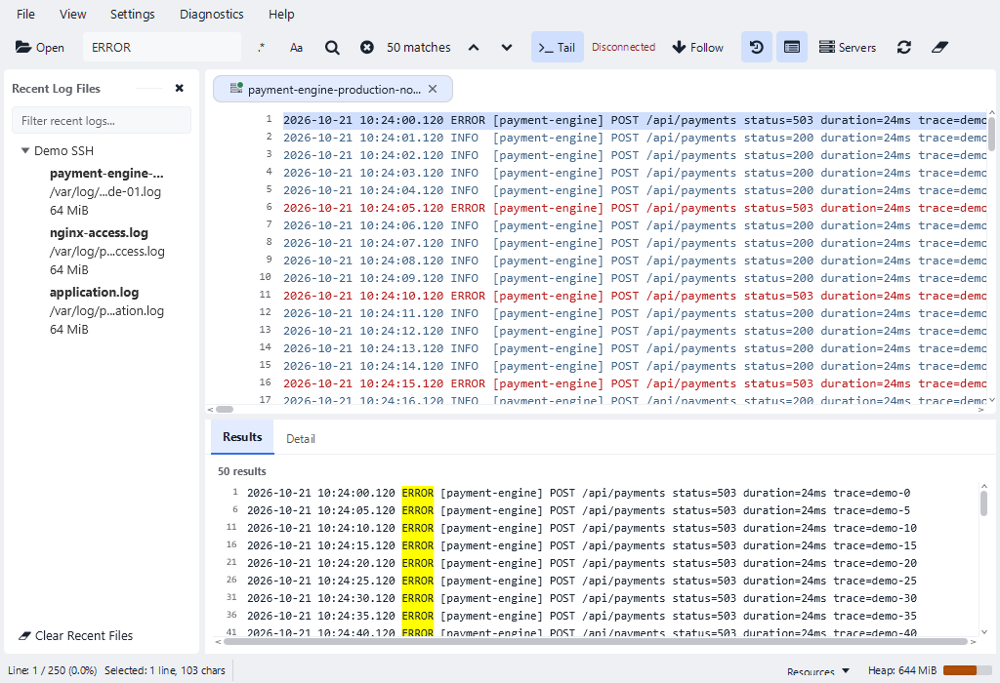

# SeeLoggyPlus - Workbench ringkas: before / after

Tanggal: 21 Oktober 2026.

> Revisi terbaru untuk bottom bar dan formatting tersedia pada [laporan revisi](chrome-revision.md). Laporan ini menyimpan hasil tahap sebelumnya.

Main workbench diperbarui dengan Results adaptif, toolbar yang mendahulukan aksi utama, serta tema Graphite Dark / Porcelain Light. Canvas dan hasil pencarian dipindahkan sebagai instance yang sama; perubahan docking tidak memuat ulang file atau menjalankan ulang query.

## Perubahan yang tersedia

| Area | Before | After |
| --- | --- | --- |
| Search results | Panel kanan untuk semua ukuran | View > Results Position: Auto / Right / Bottom; Auto memakai kanan jika area kerja setelah sidebar minimal 960 px |
| Results dan Detail | Keduanya dapat memakan ruang secara bersamaan | Pada posisi Bottom, keduanya berbagi tab; aktivasi hasil membuka Detail, Ctrl+J menampilkan/menyembunyikan Detail |
| Toolbar | Mayoritas aksi berupa ikon kecil | Open, Search, jumlah hasil, previous/next, Tail, dan Follow diprioritaskan; kontrol panel/Servers/Reload/Clear berada setelahnya dan memakai overflow native jika tidak cukup ruang |
| Sidebar | Lebar ikut berubah ketika ukuran jendela berubah | Target awal/reset 240 px, minimum 200 px; pengguna dapat resize atau menutup; nama utama dan tooltip path lengkap tetap tersedia |
| Detail | Toggle formatting JSON/XML saja | Raw / Formatted terpisah dari preferensi JSON/XML; Copy, Clear dan Close dipertahankan; aksi dapat membungkus ketika ruang sempit |
| Status Tail | Toggle dan ikon | Teks Live / Paused / Disconnected; Follow terpisah dan tidak memutus Tail |
| Resource | Tombol GC dan teks Used/Total panjang | Heap ringkas dalam MiB; Resources menampilkan used/committed/max dan menjelaskan bahwa heap bukan total RAM proses; GC melalui Diagnostics |
| Tampilan | Panel membulat 10 px dan ikon toolbar 12 px | Radius main workbench 4 px, gap luar 4 px, tombol toolbar 32 px dan ikon utama 16 px; font UI 13 px |

Pilihan tema light/dark yang tersimpan tidak diganti saat upgrade. Nilai font yang sudah disimpan tetap dipakai; fallback baru pada pengaturan/detail menjadi 13 px, sedangkan canvas mempertahankan font monospace 13 px yang sudah ada. Tidak ada dependency tema baru.

## Bukti layout dengan workload yang sama

Fixture: 250 baris sintetis payment-engine, 50 hasil ERROR, selection pada baris pertama, tiga Recent Files sintetis, satu tab log dan Detail tersedia. Nama file sengaja panjang. Label Disconnected pada screenshot benar untuk sesi demo remote tanpa koneksi jaringan. Ini bukan pengujian SSH nyata.

Capture headless Monocle/software renderer memakai ukuran scene yang sama. Setiap versi menjalani urutan resize 800x600, 1024x700, 1366x768, 1920x1080, kemudian diulang untuk tema dark; ukuran divider dapat dipengaruhi riwayat resize. Angka adalah geometry aktual, bukan perkiraan dari gambar. Luas log di bawah mencakup container/tab header; jumlah baris berasal dari kapasitas viewport canvas.

| Tema / ukuran | Container log before (px) | After (px) | Perubahan luas | Baris terlihat before / after | Screenshot |
| --- | ---: | ---: | ---: | ---: | --- |
| light-800x600 | 378 x 366 | 586 x 303 | +28.3% | 17 / 14 | [Before](assets/workbench/before/light-800x600.png) / [After](assets/workbench/after/light-800x600.png) |
| light-1024x700 | 434 x 416 | 810 x 353 | +58.4% | 20 / 16 | [Before](assets/workbench/before/light-1024x700.png) / [After](assets/workbench/after/light-1024x700.png) |
| light-1366x768 | 519 x 450 | 757 x 464 | +50.4% | 22 / 23 | [Before](assets/workbench/before/light-1366x768.png) / [After](assets/workbench/after/light-1366x768.png) |
| light-1920x1080 | 658 x 606 | 1034 x 620 | +60.8% | 30 / 31 | [Before](assets/workbench/before/light-1920x1080.png) / [After](assets/workbench/after/light-1920x1080.png) |
| dark-800x600 | 378 x 366 | 586 x 346 | +46.6% | 17 / 16 | [Before](assets/workbench/before/dark-800x600.png) / [After](assets/workbench/after/dark-800x600.png) |
| dark-1024x700 | 434 x 416 | 810 x 396 | +77.7% | 20 / 19 | [Before](assets/workbench/before/dark-1024x700.png) / [After](assets/workbench/after/dark-1024x700.png) |
| dark-1366x768 | 519 x 450 | 757 x 464 | +50.4% | 22 / 23 | [Before](assets/workbench/before/dark-1366x768.png) / [After](assets/workbench/after/dark-1366x768.png) |
| dark-1920x1080 | 658 x 606 | 1034 x 620 | +60.8% | 30 / 31 | [Before](assets/workbench/before/dark-1920x1080.png) / [After](assets/workbench/after/dark-1920x1080.png) |

Pada ukuran kecil, keuntungan utama adalah lebar baca karena Results berada di bawah. Jumlah baris vertikal tetap dilaporkan agar peningkatan luas tidak disalahartikan sebagai peningkatan semua dimensi. Pengguna tetap dapat memilih Right atau mengubah divider sendiri.

### Contoh light, 1024 x 700

Before:

After:

### Contoh dark, 1366 x 768

[Before Graphite](assets/workbench/before/dark-1366x768.png) / [After Graphite](assets/workbench/after/dark-1366x768.png)

## Implementasi dan kompatibilitas

- Docking dikapsulkan pada WorkbenchDock di lapisan app. Resize yang tidak mengubah susunan panel tidak membangun ulang tab/viewer. Pemulihan divider dikoaleskan satu kali setelah perubahan susunan, sehingga batas sementara ketika resize tidak menjadi ukuran Results permanen.
- Selection hasil, query dan tab Detail yang dipilih bertahan saat pindah posisi. Close Detail tetap menyisakan Results. Hasil nol untuk Tail tetap terlihat dan bisa diperbarui saat baris baru masuk.
- Preference tambahan: `workbench_results_position`, `workbench_sidebar_divider`, `workbench_right_divider`, `workbench_bottom_divider`. Penyimpanan ukuran dilakukan setelah drag selesai melalui satu worker dengan satu slot pending; worker idle berakhir setelah lima detik. Nilai invalid memakai fallback.
- Reset Layout mengembalikan Auto, sidebar terbuka, Detail tersedia, serta divider default; tidak mengganti tema atau query. Nilai panel-pinned yang lama tetap dibaca. Tidak ada migrasi database atau perubahan kontrak log/Tail.
- RoundedPanelSupport mendapat overload radius; pemanggil lain tetap memakai radius lama. Token light/dark tetap mempunyai himpunan yang sama. Kontras ikon/label tidak diturunkan.
- Raw / Formatted tidak mengubah preferensi JSON/XML; generation guard formatter background tetap menjaga agar job lama tidak menimpa konten baru.

## Validasi

Hasil akhir: **182/182 tes lulus pada 22 kelas terkait**, tanpa failed/skipped. Daftar kelas, jumlah tes, dan status akhir tercantum pada [selected-tests.json](assets/workbench/selected-tests.json). Pengujian mencakup docking Auto/Right/Bottom, restore preference, nilai NaN, reset, selection/query, tab Detail, Tail vs Follow, layout kecil, overflow, FXML, pencarian local/remote, formatter async, tema, serta kontras. Semua tes berjalan headless; full suite tidak dijalankan.

Tes layout lama diperbarui untuk kontrak desain baru: tombol 32 px, radius 4 px dan token warna baru. Tes pencarian lama yang mengasumsikan panel selalu di kanan atau scan Tail sinkron disesuaikan dengan docking/background search; assertion jumlah hasil, konten, error regex dan stale-result tetap diperiksa.

[Smoke final](assets/workbench/smoke.json) mencatat startup detached, pemeriksaan FXML/error startup, penghentian melalui scripts/stop-app.ps1, dan cleanup log root. Screenshot adalah hasil headless; smoke native memverifikasi startup, bukan sertifikasi seluruh interaksi di setiap DPI Windows.

Bukti mentah geometry: [before](assets/workbench/before/metrics.json) / [after](assets/workbench/after/metrics.json). Baseline dijalankan kembali memakai class/resources snapshot sebelum redesign, sehingga data fixture, pemilihan baris, jumlah hasil, dan Recent Files sama. Manifest sumber baseline dan after disimpan bersama aset laporan.

Tidak ada benchmark RAM/throughput baru yang diklaim untuk redesign ini. Docking menggunakan listener resize/state tanpa render loop baru; pembacaan file, cold Tail, dan formatting besar tetap mengikuti jalur background yang sudah ada. Pengukuran resource sebelumnya beserta target yang belum tercapai tersedia pada [audit performance](performance-audit.md).

## Cara mencoba

1. Buka file, cari ERROR, lalu ubah ukuran jendela untuk melihat posisi Auto berpindah.
2. Pilih View > Results Position untuk memaksa Right atau Bottom.
3. Aktifkan hasil pencarian untuk membuka Detail; coba Raw / Formatted dan Copy.
4. Coba Ctrl+B, Ctrl+J, serta Follow saat Tail berjalan.
5. Ubah tema melalui Preferences; gunakan View > Reset Layout untuk kembali ke susunan awal.

### Kelas tes terkait

| Kelas | Passed |
| --- | ---: |
| `com.seeloggyplus.app.ButtonThemeTest` | 6 |
| `com.seeloggyplus.app.IconContrastTest` | 4 |
| `com.seeloggyplus.app.LabelContrastTest` | 3 |
| `com.seeloggyplus.app.MainControllerHelperLogicTest` | 20 |
| `com.seeloggyplus.app.MainControllerReachableFlowsTest` | 29 |
| `com.seeloggyplus.app.MainControllerTabLifecycleTest` | 14 |
| `com.seeloggyplus.app.MainViewCompactLayoutTest` | 6 |
| `com.seeloggyplus.app.MainViewFxmlLoadTest` | 18 |
| `com.seeloggyplus.app.MainViewIconsTest` | 4 |
| `com.seeloggyplus.app.MainViewIslandLayoutTest` | 5 |
| `com.seeloggyplus.app.SearchFeatureE2ETest` | 5 |
| `com.seeloggyplus.app.SearchResultsRegressionTest` | 13 |
| `com.seeloggyplus.app.SettingsLayoutTest` | 2 |
| `com.seeloggyplus.app.WorkbenchCaptureTest` | 1 |
| `com.seeloggyplus.app.WorkbenchLayoutTest` | 7 |
| `com.seeloggyplus.features.detail.presentation.DetailPanelThemeTest` | 5 |
| `com.seeloggyplus.features.detail.presentation.LogDetailPaneAsyncCoverageTest` | 7 |
| `com.seeloggyplus.features.detail.presentation.LogDetailPaneControllerTest` | 12 |
| `com.seeloggyplus.features.search.presentation.SearchPanelThemeTest` | 6 |
| `com.seeloggyplus.shared.ui.canvas.CanvasSelectionRenderingRegressionTest` | 8 |
| `com.seeloggyplus.shared.ui.canvas.CanvasThemeTest` | 4 |
| `com.seeloggyplus.shared.util.ThemeTokensTest` | 3 |
